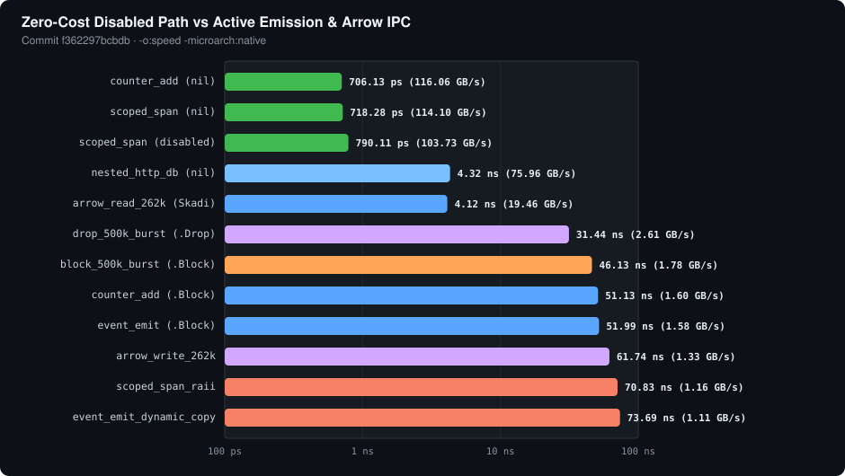
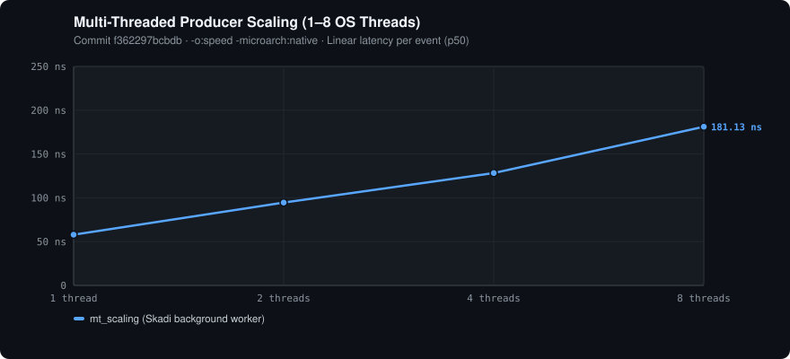
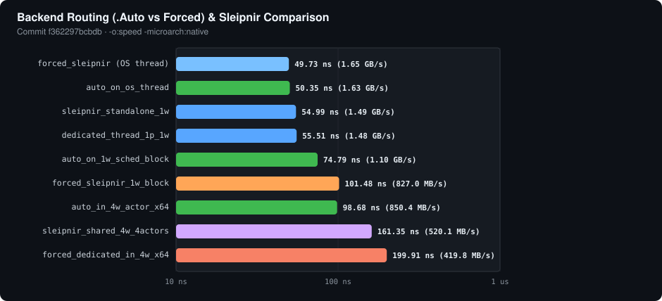

[Root README](../README.md) · **Suite Renders**

# Heimdall Benchmarks & Visual Renders

Pure-Odin throughput, latency, scaling, and Arrow IPC I/O benchmark suite for **Heimdall** (`31` benchmarks across `7` groups, `389` samples at commit `f362297bcbdb` in [`history.hugidb`](history.hugidb)), with visual SVG charts rendered via [`temple`](https://github.com/boxxxie/temple) under [`renders/`](renders/).

---

## Visual Renders (`-o:speed`)

### 1. Zero-Cost Disabled Path vs Active Emission & Arrow IPC



### 2. Multi-Threaded OS Producer Scaling (`1`–`8` Threads)



### 3. Backend Routing (`.Auto` vs Forced) & Sleipnir Actor Comparison



---

## Reproducing & Regenerating Renders

```bash
# 1. Run the suite and append results to benchmarks/history.hugidb
hugi run benchmarks --runs 5

# 2. Run a subset of groups without modifying history.hugidb
hugi run benchmarks --no-db --runs 1 --groups zero_cost,single_thread

# 3. Statistically compare the last two commits (Mann-Whitney U / Welch t-test)
hugi compare --last

# 4. Regenerate SVG charts in benchmarks/renders/ and tables below using temple AOT templates
odin run benchmarks/render -collection:temple=../temple
```

---

## Full Benchmark Results (`31` Benchmarks at `f362297bcbdb`)

<!-- BEGIN_BENCHMARK_TABLE -->
### `zero_cost` — Disabled / `nil` Recorder Short-Circuit (`4` benchmarks)

`nil` and disabled `^heimdall.Recorder` short-circuit checks enforced with `0 B` heap allocations.

| Benchmark | Median (`p50`) | `P95` | Throughput / Ops | `CV%` | Allocs / op |
| :--- | ---: | ---: | ---: | ---: | ---: |
| `scoped_span_nil` | **718.28 ps** | 946.13 ps | 114.10 GB/s | 12.1% | **0** |
| `counter_add_nil` | **706.13 ps** | 710.00 ps | 116.06 GB/s | 0.6% | **0** |
| `scoped_span_disabled` | **790.11 ps** | 796.47 ps | 103.73 GB/s | 1.1% | **0** |
| `nested_http_db_nil` | **4.32 ns** | 4.34 ns | 75.96 GB/s | 0.6% | **0** |
### `single_thread` — Single-Thread `#soa` Ring & Arrow Flush (`6` benchmarks)

Single-threaded `#soa` staging ring ingestion, scoped spans, nested contexts, and Arrow IPC flush.

| Benchmark | Median (`p50`) | `P95` | Throughput / Ops | `CV%` | Allocs / op |
| :--- | ---: | ---: | ---: | ---: | ---: |
| `event_emit_block` | **51.99 ns** | 53.67 ns | 1.58 GB/s | 4.4% | 0.0 (24 B) |
| `counter_add_block` | **51.13 ns** | 52.98 ns | 1.60 GB/s | 4.2% | 0.0 (24 B) |
| `scoped_span_raii` | **70.83 ns** | 74.71 ns | 1.16 GB/s | 3.0% | 0.0 (26 B) |
| `http_db_tree_2level` | **64.65 ns** | 67.94 ns | 1.27 GB/s | 4.9% | 0.0 (26 B) |
| `call_tree_3level` | **70.03 ns** | 74.67 ns | 1.17 GB/s | 3.4% | 0.0 (24 B) |
| `event_emit_dynamic_copy` | **73.69 ns** | 85.72 ns | 1.11 GB/s | 7.6% | 0.0 (107 B) |
### `backpressure` — 500K Burst Saturation (`.Drop` vs `.Block`) (`2` benchmarks)

500K burst saturation comparing non-blocking `.Drop` against lossless `.Block`.

| Benchmark | Median (`p50`) | `P95` | Throughput / Ops | `CV%` | Allocs / op |
| :--- | ---: | ---: | ---: | ---: | ---: |
| `drop_500k_burst` | **31.44 ns** | 32.33 ns | 2.61 GB/s | 1.4% | 0.0 (13 B) |
| `block_500k_burst` | **46.13 ns** | 47.69 ns | 1.78 GB/s | 3.5% | 0.0 (13 B) |
### `mt_scaling` — Multi-Threaded OS Producer Scaling (`1`–`8` Threads) (`4` benchmarks)

Multi-threaded OS producer scaling across 1, 2, 4, and 8 threads feeding a Skadi worker.

| Benchmark | Median (`p50`) | `P95` | Throughput / Ops | `CV%` | Allocs / op |
| :--- | ---: | ---: | ---: | ---: | ---: |
| `threads_1` | **57.85 ns** | 61.21 ns | 1.42 GB/s | 3.5% | 0.0 (26 B) |
| `threads_2` | **94.61 ns** | 99.59 ns | 887.1 MB/s | 2.9% | 0.0 (28 B) |
| `threads_4` | **128.32 ns** | 130.10 ns | 654.0 MB/s | 1.0% | 0.0 (29 B) |
| `threads_8` | **181.13 ns** | 184.03 ns | 463.3 MB/s | 1.7% | 0.0 (29 B) |
### `sleipnir_vs_thread` — `.Dedicated_Thread` vs `.Sleipnir_Actor` (`7` benchmarks)

Comparing `.Dedicated_Thread`, standalone/shared Sleipnir schedulers, `.Flush_Sync`, and lifecycle churn.

| Benchmark | Median (`p50`) | `P95` | Throughput / Ops | `CV%` | Allocs / op |
| :--- | ---: | ---: | ---: | ---: | ---: |
| `dedicated_thread_1p_1w` | **55.51 ns** | 57.57 ns | 1.48 GB/s | 2.2% | 0.0 (26 B) |
| `sleipnir_actor_standalone_1w` | **54.99 ns** | 57.57 ns | 1.49 GB/s | 2.6% | 0.0 (26 B) |
| `sleipnir_actor_shared_4w_4actors` | **161.35 ns** | 165.70 ns | 520.1 MB/s | 1.5% | 0.0 (29 B) |
| `sleipnir_actor_flush_sync_x8` | **79.18 ns** | 84.41 ns | 1.04 GB/s | 3.5% | 0.0 (13 B) |
| `sleipnir_actor_standalone_2page_block` | **76.37 ns** | 79.93 ns | 1.07 GB/s | 3.3% | 0.0 (26 B) |
| `sleipnir_actor_shared_2page_block` | **167.12 ns** | 169.28 ns | 502.2 MB/s | 2.1% | 0.0 (29 B) |
| `sleipnir_actor_lifecycle_shutdown_x16` | **99.70 ns** | 103.19 ns | 841.7 MB/s | 2.5% | 0.0 (192 B) |
### `auto_backend` — `.Auto` Routing vs Forced Backends (`6` benchmarks)

`Backend_Mode.Auto` adaptive selection vs forced `.Dedicated_Thread` / `.Sleipnir_Actor` overrides.

| Benchmark | Median (`p50`) | `P95` | Throughput / Ops | `CV%` | Allocs / op |
| :--- | ---: | ---: | ---: | ---: | ---: |
| `forced_dedicated_thread_in_4w_actor_x64` | **199.91 ns** | 219.05 ns | 419.8 MB/s | 10.1% | 0.0 (283 B) |
| `auto_in_4w_actor_x64` | **98.68 ns** | 105.47 ns | 850.4 MB/s | 4.0% | 0.0 (285 B) |
| `forced_sleipnir_actor_1w_block` | **101.48 ns** | 105.40 ns | 827.0 MB/s | 2.4% | 0.0 (19 B) |
| `auto_on_1w_sched_block` | **74.79 ns** | 77.65 ns | 1.10 GB/s | 5.5% | 0.0 (18 B) |
| `forced_sleipnir_actor_os_thread` | **49.73 ns** | 50.31 ns | 1.65 GB/s | 0.8% | 0.0 (7 B) |
| `auto_on_os_thread` | **50.35 ns** | 53.82 ns | 1.63 GB/s | 3.7% | 0.0 (7 B) |
### `arrow_io_roundtrip` — 262K-Row `.arrow` IPC Write & Scan (`2` benchmarks)

End-to-end 262,144-row `.arrow` IPC segment write and `Skadi` `ipc_read_file` scan.

| Benchmark | Median (`p50`) | `P95` | Throughput / Ops | `CV%` | Allocs / op |
| :--- | ---: | ---: | ---: | ---: | ---: |
| `arrow_write_262k` | **61.74 ns** | 77.77 ns | 1.33 GB/s | 13.6% | 0.0 (26 B) |
| `arrow_read_262k` | **4.12 ns** | 4.77 ns | 19.46 GB/s | 13.3% | 0.0 (0 B) |
<!-- END_BENCHMARK_TABLE -->
